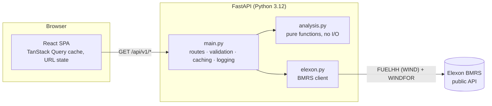

# WindDesk: day-ahead wind forecast monitor

WindDesk helps a GB utility's day-ahead trading desk answer three questions before each auction:

1. **What did the latest wind forecast say when I had to decide?** For any decision day in January 2026, it shows the forecast that was actually available at the gate, and the outturn that followed.
2. **How far can I trust it?** It measures the forecast's error over the whole month, sets a shortfall buffer from that error, and checks how much a simple calibration would have helped.
3. **So how much should I buy beyond wind?** Every decision day gets a **buy plan**: the wind to plan on at the desk's risk level, and how much more than the raw forecast suggests must therefore be bought, split into forecast-bias correction and safety margin. The Buy planner page sets that risk level from what being short and being long cost, using the newsvendor rule from the wind-trading literature, and backtests January in £.

**Live app:** https://kwcstf.vercel.app · **API docs:** https://kwcstf.vercel.app/docs

**Videos:**

- [Part 1 – Client Pilot Presentation: WindDesk Portal and Analysis](https://youtu.be/f_cNFZJQdeY)
- [Part 2 – Tech Lead Review and Knowledge Transfer: WindDesk Architecture, Design, Analysis and Codebase](https://youtu.be/2pq833DHyRk)

---

## What the January 2026 data says

All figures use the EPEX 09:20 gate. You can switch to N2EX 09:50 or any custom time in the app.

| Finding | Number |
| --- | --- |
| The forecast ran **high** on average (wind under-delivered) | **+1,748 MW** bias, on 27 of 31 delivery days |
| Typical miss (MAE / RMSE) | 2,039 MW / 2,505 MW (18.1% of mean output) |
| P90 shortfall: a buffer this size covered the shortfall in 90% of evaluated hours | **4,098 MW** (worst single hour: 6,870 MW) |
| Calibrating with **only outturn published by the gate** | MAE 2,030 → **1,463 MW (−28%)**, P90 buffer 4,174 → 2,861 MW |
| Deciding at N2EX 09:50 instead of EPEX 09:20 (one more forecast run) | −26 MW MAE: small next to the bias |
| **Buy planner**, short costs £40/MWh and long £20/MWh: plan to P33 wind | Imbalance cost £7.14 → **£3.93/MWh of wind (−45%)**, about £2.2m over January for a 1 GW book |
| Same, short £60 and long £15/MWh: plan to P20 wind | **−61%** vs the raw forecast, −25% vs the calibrated median |
| Does the theory hold? Cheapest planning level found in the backtest (tested in steps of 5) | P35 vs formula P33; P25 vs P25; P20 vs P20 |

Most of the error is a consistent over-forecast, not random noise, and that kind of error can be corrected. A likely cause is that metered output (FUELHH) is net of wind turned down for grid constraints, which a weather-driven forecast (WINDFOR) does not predict. Confirming that needs balancing-mechanism data, which is outside this pilot's scope (see [Next steps](#next-steps)).

## The buy planner: why it is the right decision rule

The desk plans a volume of wind and buys the rest day-ahead. If wind comes in below the plan, the gap is bought later at a premium (`c_short` £/MWh). If it comes in above, the surplus is sold back at a discount (`c_long` £/MWh). Expected cost is minimised by planning to the **wind quantile at level `c_long / (c_short + c_long)`**. This is the newsvendor critical ratio, the standard result for trading wind with probabilistic forecasts (Bremnes 2004; Pinson, Chevallier & Kariniotakis, *IEEE Trans. Power Systems* 22(3), 2007; Zugno, Jónsson & Pinson, *Wind Energy*, 2013).

- **No extra data, no look-ahead:** the quantiles come from the forecast's own past errors, using only hours whose outturn Elexon had published by that day's cut-off. Every plan therefore uses only what was known at the gate.
- **Costs are inputs:** they are the desk's assumptions, not market prices, because the brief limits the pilot to Elexon wind data. The £/MWh results therefore follow from the costs entered. For scale: at £20/MWh each way, the calibrated plan costs £2.68 per MWh of wind, the same order as AFRY's projection of £2–4/MWh for wind's within-day re-trading cost.
- **Like-for-like energy:** each hour is costed on its average outturn (the mean of its two half-hours), so an hour at X MW is X MWh, consistent with the day view's energy totals.
- **Scale-free results:** £/MWh does not depend on book size. The £ figures scale linearly with the book size the user enters, which assumes the book follows the GB wind profile scaled to its size.
- **Checked against data:** the backtest also sweeps every planning level from P5 to P95. In January the cheapest level landed at or within one step of the formula's level for every cost setting tested. The app computes this agreement rather than asserting it, and says so when the two differ.

### The buy plan on each decision day

The brief asks how much power must be procured beyond wind. That is **demand − the wind the desk can rely on**. Demand is outside the pilot's data, so the app answers the wind half precisely:

- **Wind to plan on** = forecast − the past-error quantile at `1 − level`, hour by hour (floored at zero), using only outturn published by the gate.
- **Extra to buy** = raw forecast − wind to plan on. It splits into:
  - **bias correction:** the median plan, i.e. the forecast's typical over-statement;
  - **safety margin:** the gap from the median to the chosen level, i.e. the cover for shortfall being dearer than surplus.
- At P50 the plan equals the calibrated forecast exactly (tested). Total to buy day-ahead is the desk's demand minus the planned wind.

## Domain model and the decisions behind it

| Question | Decision |
| --- | --- |
| What does "decisions made in January 2026" cover? | Decision days **1–31 Jan 2026**, so delivery days **2 Jan – 1 Feb 2026**. Delivery days are UK settlement days (00:00–24:00 UK time). |
| When is the decision made? | At the D-1 **gate closure**: EPEX SPOT GB hourly auction 09:20 UK (default) or Nord Pool N2EX 09:50 UK. Any custom time can be chosen. |
| Which forecast counts? | For each delivery hour, the **latest WINDFOR run published at or before the gate**. Nothing published later is ever used (no look-ahead). |
| Data quirks handled | Each WINDFOR run also repeats about a day of hours that had already passed. Those rows are dropped because they are not forecasts. Publish times are irregular (for example 12:25 instead of 11:30), so nothing assumes a fixed schedule. FUELHH revisions: the latest publish wins. |
| Resolution | FUELHH gives average MW per half hour; WINDFOR is hourly, and each value is treated as the average MW of the hour it starts (assumption). Each hourly forecast is scored against the **mean of that hour's two half-hours**, so errors, energy totals and £ all describe the same quantity. An hour missing either half-hour is not scored. The chart still draws half-hourly actuals. |
| Sign convention | `error = forecast − actual`. Positive means the buyer was **short** and had to top up intraday or pay imbalance. |
| Calibration | Shift each forecast by the **median error of hours whose outturn Elexon had published by that decision's cut-off**, using at least 48 such hours, and floor at zero. FUELHH publish times are kept for this. A revised slot counts as known only from its latest publish time, which is conservative. The P10–P90 range comes from the same errors, so the app only shows what a trader could have known at the gate. |
| Clock changes | All maths is in UTC. Delivery days and gates are built through `Europe/London`, so 46- and 50-period days are handled (tested). |

## Architecture



- **`elexon.py`** fetches both datasets in parallel, using `httpx` with retries and timeouts. It turns them into one small, typed `WindData` structure: actuals by slot, plus each target hour's forecast history sorted by publish time.
- **`analysis.py`** holds all domain logic as pure functions. The core rule is `forecast_at(target, cutoff)`, a binary search (`bisect`) over a target's forecast runs. Every view, metric and sweep is built on it, so the no-look-ahead rule is enforced in one place.
- **`main.py`** stays thin. It validates input with typed query params (out-of-range days and malformed times get a 422) and caches per process. It also maps upstream failures to a clean 502 and sets HTTP cache headers. Response types are the same dataclasses the analysis returns, so the OpenAPI schema at `/docs` always matches the code.
- **Caching:** January 2026 is history and never changes. The data is fetched once per process (about 1.7 s), and every later request takes milliseconds. Responses carry `s-maxage` so the CDN can serve them too, and the browser keeps them with `staleTime: Infinity`.
- **Frontend:** TanStack Query handles server state, request de-duplication and **prefetching of the neighbouring days**, so stepping through the month is instant. View state (tab, day, gate) lives in the URL, so any view can be shared by link. Recharts draws the charts. Vendor code is split into its own chunks so it stays cached across deploys.
- **UX:** a standard light product layout: sidebar navigation, breadcrumbs, and the gate selector as the main action in the header.
  - The decision page opens with a day picker: the 31 decision days as tiles tinted by forecast bias. It shows either as a month calendar (with a short month summary beside it) or as a horizontally scrollable row with arrow buttons. The layout choice is remembered per device, and the arrow keys step through days.
  - The detail opens with the day's buy plan, with risk presets P50/P33/P20. It then shows KPIs, the generation profile with the planned wind line, a D-1 timeline of forecast runs against the gate, and an hourly table with a Plan column.
  - Chart legends double as series toggles.
  - Figures ease between days, pages fade in, and loading uses skeletons. Motion is disabled under `prefers-reduced-motion`.
  - An error boundary keeps a rendering bug in one view from blanking the page.

### Why no pandas

The data is about 20k forecast rows and 1.5k actuals. Standard-library `bisect` and `statistics` do the job in milliseconds with fewer dependencies and a faster cold start. If the scope grows to many datasets or years, the selection rule maps directly to `pandas.merge_asof` or Polars `join_asof`.

## API

| Endpoint | Purpose |
| --- | --- |
| `GET /api/v1/meta` | Pilot window, gate presets, default gate |
| `GET /api/v1/decision?day=2026-01-14&gate=09:20&plan_level=0.33` | Forecast at the gate for delivery day D, actuals, day stats, calibration, and the buy plan at `plan_level` (default 0.5) |
| `GET /api/v1/accuracy?gate=09:20` | Month-wide error stats, by day, by delivery hour, histogram, calibration gain |
| `GET /api/v1/gate-sweep` | Month-wide accuracy for every decision time on D-1 (10-minute steps) |
| `GET /api/v1/procurement?gate=09:20&cost_short=40&cost_long=20` | Buy-planner backtest: raw vs median vs risk-optimal plan, daily costs, cost-by-planning-level curve |
| `GET /api/health` | Liveness |

Interactive OpenAPI docs are served at `/docs`.

## Repository layout

```
.
├── backend/
│   ├── app/
│   │   ├── elexon.py          # Elexon BMRS client: fetch, clean, index WINDFOR and FUELHH
│   │   ├── analysis.py        # Domain logic: gate selection, error stats, calibration, sweep
│   │   └── main.py            # FastAPI app: routes, validation, caching, logging, static files
│   ├── tests/
│   │   ├── conftest.py        # Synthetic data with known answers
│   │   ├── test_analysis.py   # No look-ahead, clock changes, stats, binning, calibration, newsvendor backtest
│   │   ├── test_elexon.py     # Parsing: elapsed-hour rows dropped, latest revision wins
│   │   └── test_api.py        # Contract, validation (422), upstream failure (502), cache headers
│   ├── requirements.txt       # Runtime dependencies (pinned)
│   ├── requirements-dev.txt   # + pytest, ruff
│   ├── ruff.toml              # Lint and format config
│   └── .python-version        # 3.12 (used by Vercel)
├── frontend/
│   ├── src/
│   │   ├── api.ts             # Typed API client and query definitions
│   │   ├── App.tsx            # Shell: sidebar, breadcrumbs, gate selector
│   │   ├── useUrlState.ts     # View state in the URL
│   │   ├── format.ts          # UK-time and number formatting
│   │   ├── styles.css
│   │   └── components/
│   │       ├── DecisionView.tsx   # Day detail: KPIs, profile chart, run timeline, hourly table
│   │       ├── DayPicker.tsx      # Decision days as a heat-tinted calendar or scrollable row
│   │       ├── RunTimeline.tsx    # D-1 timeline: forecast runs vs the gate
│   │       ├── AccuracyView.tsx   # Month view: findings, metrics, four charts
│   │       ├── PlannerView.tsx    # Buy planner: cost inputs, recommendation, £ backtest
│   │       ├── GateControl.tsx    # EPEX / N2EX / custom cut-off
│   │       ├── ErrorBoundary.tsx  # Contain rendering errors to one view
│   │       └── ui.tsx             # Card, KPI, eased numbers, skeletons, legend toggles
│   ├── index.html
│   ├── package.json
│   ├── .prettierrc
│   └── vite.config.ts         # Dev proxy to the API, vendor chunking
├── .github/workflows/ci.yml   # ruff + pytest, Prettier + tsc + build, Docker build
├── Dockerfile                 # Multi-stage: build React, serve it and the API from one Python image
├── docker-compose.yml
└── vercel.json                # Vercel Services: Vite frontend + FastAPI backend in one project
```

## Running it

### Docker (one command)

```bash
docker compose up --build
```

Open http://localhost:8000. The first request loads January's data from Elexon (about 2 s).

### Local development

Needs Python 3.12+ and Node 20.19+.

```bash
# API on :8000
python -m venv .venv && .venv/bin/pip install -r backend/requirements-dev.txt
.venv/bin/uvicorn app.main:app --app-dir backend --reload --port 8000

# Frontend on :5173 (proxies /api to :8000), in a second terminal
cd frontend && npm install && npm run dev
```

### Tests and checks

```bash
cd backend && ../.venv/bin/python -m pytest -q && ../.venv/bin/ruff check . && ../.venv/bin/ruff format --check .
cd frontend && npm run lint && npm run build   # Prettier check, strict TypeScript, production build
```

CI runs the same checks on every push and pull request, and also builds the Docker image.

### Deploying

`vercel.json` defines two Vercel Services in one project: the Vite frontend and the FastAPI backend, with `/api/*` routed to the backend. Deploy with:

```bash
vercel deploy --prod
```

## Engineering notes

- **Correctness first:** the tests use synthetic data with known answers. They cover the no-look-ahead rule and inclusive cut-off, 46/48/50-period days, GMT vs BST gates, and the error sign. They also cover histogram binning of negatives and the API contract.
- **Regression tests for two subtle traps:** learning from outturn not yet published at the gate, and costing half-hours as full hours. Each is pinned by a concrete case:
  - Rewriting post-gate outturn must not change a calibration or a plan.
  - Forecasting 1,000 MW against 800/1,800 MW half-hours must score −300 MW and book a surplus, not a shortfall.
- **Errors:** Elexon outages return a 502 with a readable message. They are never cached, so the next request retries. Invalid input returns a 422 with the field and the reason.
- **Observability:** every request is logged with status and duration, and a `Server-Timing` header shows it in browser dev tools. Upstream fetches log row counts and latency.
- **Deliberate simplifications:** the cache is per process with no lock, so two cold requests may both fetch (fine at pilot traffic). The calibration is a constant shift. Both are noted in the code where they live.

## Next steps

1. **Explain the bias:** add Elexon BOALF/BOD (bid acceptances) to test the curtailment hypothesis, and calibrate on forecast "available wind" rather than metered output.
2. **Better calibration:** condition the shift and band on forecast level and lead time (errors grow with output), and use a rolling window to track regime changes.
3. **Make it operational:** a scheduled ingest into Postgres instead of fetching on demand, a rolling "today" view, and alerts when a new run moves the forecast past a threshold.
4. **Real prices in the planner:** replace the cost assumptions with Elexon system prices and intraday spreads, conditioned on the wind error (short wind tends to coincide with a short, expensive system). Then combine with the client's demand forecast to output a buy volume per hour.

## Use of AI tools

I used [Antigravity](https://antigravity.google), an AI coding assistant, while working on this project, for code drafting, refactoring and documentation. All domain decisions, analysis results and code were reviewed and checked against the live Elexon data and the test suite.
